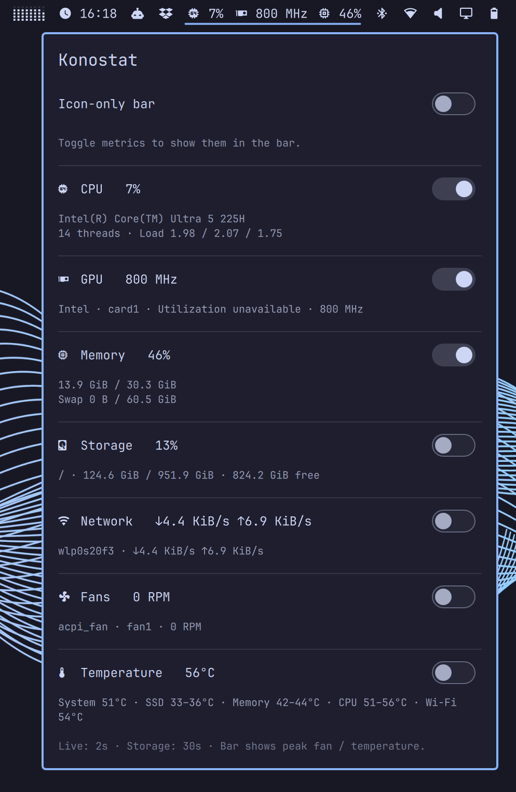

# Konostat

Part of **Konochi**, a personal Omarchy plugin series by Alec Xu.

A native Omarchy / Quickshell plugin. Plugin ID: `konochi.konostat`.

## Preview



## Usage

- Left-click the system status icon in the bar to open the panel. Press Escape
  or click outside to close it.
- The panel displays CPU, GPU, memory and swap, local storage, network upload
  and download speeds, fans, and temperature sensors.
- Each metric's switch controls whether it appears in the bar, without affecting
  data collection or its visibility in the panel.
- The icon-only switch at the top hides all bar values while preserving metric
  selections.
- Icon-only mode is enabled by default, with CPU and memory selected. Disable
  icon-only mode to display their values.
- Settings are saved through Omarchy's native API to
  `~/.config/omarchy/shell.json` and persist across restarts.
- The panel scrolls when necessary, supports horizontal and vertical bars, and
  follows the current theme.

## Data sources and limitations

Uses only Python 3's standard library. No network access or package installation
is required.
A single shared collector updates every two seconds; storage information is
refreshed every 30 seconds. Collection failures are retried automatically.

- **CPU:** deltas from `/proc/stat`. Usage is unavailable during the first
  sample after startup. Memory usage is based on `MemAvailable`.
- **GPU:** sysfs utilization and VRAM data where exposed by drivers such as
  AMD; current Intel GPU frequency where readable. An already-installed
  `nvidia-smi` provides NVIDIA utilization, VRAM, temperature, and fan percentage.
  Unsupported utilization is explicitly marked unavailable; the plugin does
  not request perf or root permissions.
- **Storage:** local `/dev/` filesystems, with subvolumes on the same device
  deduplicated. Boot/EFI and network mounts are excluded. The bar displays the
  first mount point, preferring `/`.
- **Network:** byte-counter deltas from active physical interfaces, summed for
  upload and download. Virtual interfaces are excluded to avoid double-counting
  VPN or bridge traffic.
- **Fans and temperatures:** `/sys/class/hwmon`, with thermal zones as a fallback
  when hwmon temperatures are unavailable. The panel groups temperature ranges
  by component, such as CPU, SSD, and memory; the bar shows the highest reading.
  Zero RPM is retained as a valid sensor reading. NVIDIA percentage-only fan
  readings appear in GPU details and are not presented as RPM.

## Management and diagnostics

```sh
omarchy plugin validate ~/.config/omarchy/plugins/konochi.konostat
omarchy plugin enable konochi.konostat
omarchy plugin disable konochi.konostat
omarchy-shell konochi.konostat status
omarchy-shell shell summon konochi.konostat '{}'
python3 -B ~/.config/omarchy/plugins/konochi.konostat/collect.py --once
```

Run `python3 -B -m unittest discover -v` from this directory to run tests.

## Install and remove

Requires Omarchy Quattro and Python 3. NVIDIA metrics optionally use
`nvidia-smi`. No additional installer, standalone system service, or privileged
setup is required.

```sh
omarchy plugin add https://github.com/xvvhang/omarchy-konostat-plugin --enable
omarchy plugin disable konochi.konostat
omarchy plugin remove konochi.konostat
```

Removal does not change hardware settings, other plugins, or unrelated user
files. Back up unpushed development changes before removing the plugin.

Use Qt 6 for QML validation (the default `qmllint` on PATH may be Qt 5):

```sh
omarchy plugin validate .
/usr/lib/qt6/bin/qmllint -I /usr/share/omarchy/shell ./*.qml
```

MIT licensed; see LICENSE.
